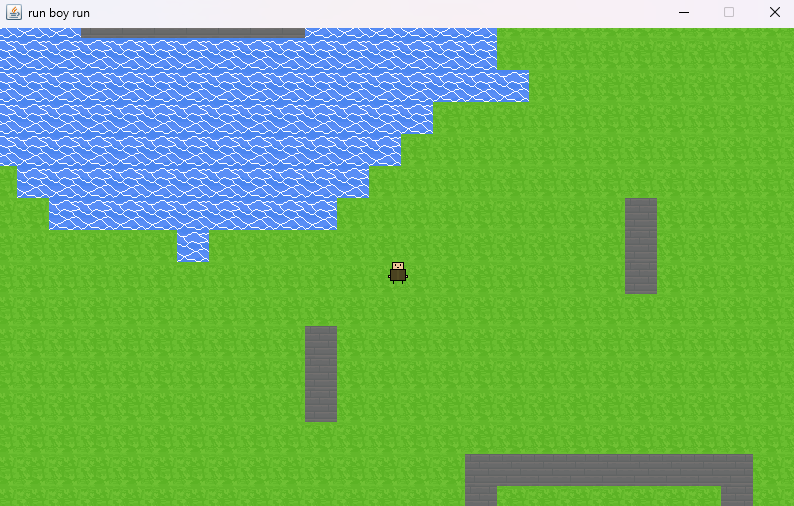
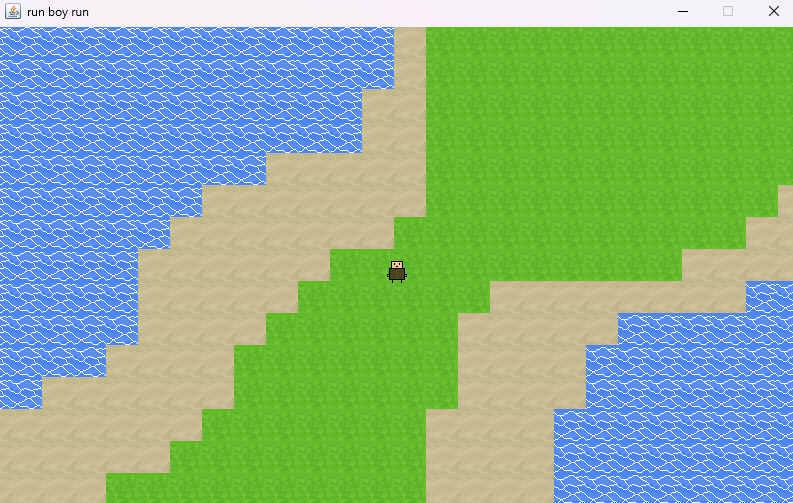

# proj4_RunBoyRun
A short scope 2D game where u can move around, a camera follows you and some collision checks exists. Will try to add a generating world now that the original scope is done!
This project has taught me alot about the how to use and the math behind a moving player, a camera, generating tiles, a collisionsystem. Not entirely easy but happy to have made it work!

Image of titleScreen.

Image of a static map.

Image of the generated terrain.

