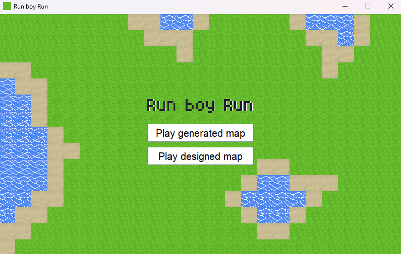
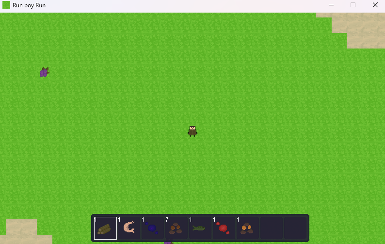
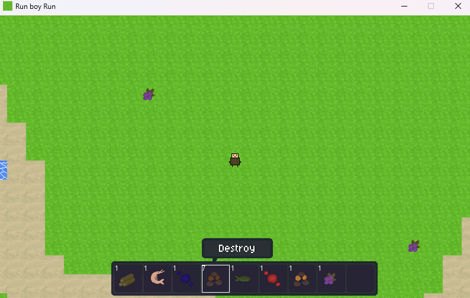

# proj4_RunBoyRun
Original scope was a moveable character, a map made of tiles, a simple collision check, [x] completed
Implemented an usable hotbar, item pickup, item use and destroy from rightclick, randomly spawnable items in the world, eatable items, healthbar, gameloop, a lot of bugfixes & improvements, [x] completed

Still working on implementing more, see "Future Goals"!

Image of titleScreen.

Image of a generated map.

Image of removing an item.

