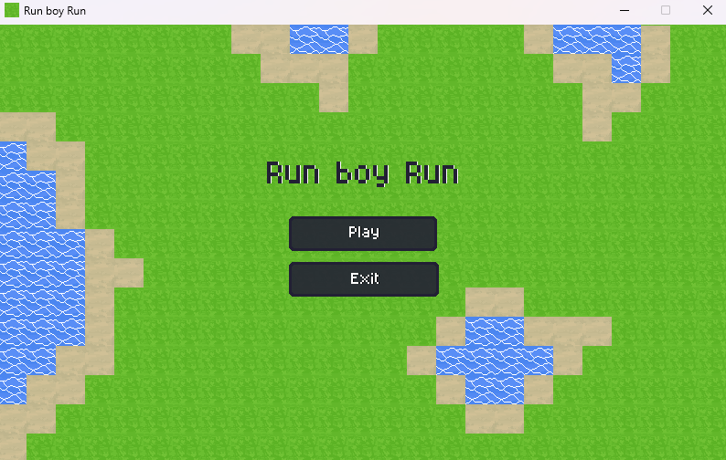
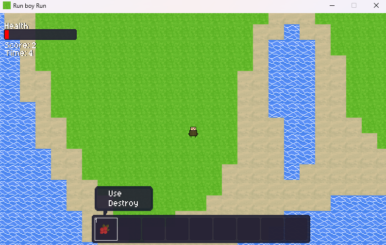
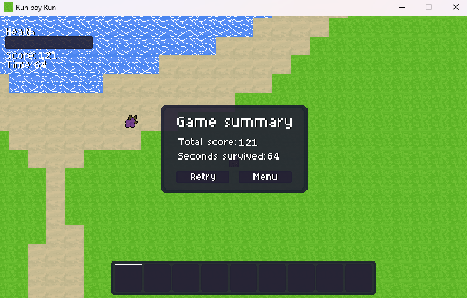

# proj4_RunBoyRun
https://doobs67.itch.io/run-boy-run official itch.io page!
Original scope was a moveable character, a map made of tiles, a simple collision check, [x] completed

Further implemented an usable hotbar, item pickup, item use and destroy from rightclick, randomly spawnable items in the world, eatable items, healthbar, gameloop, a lot of bugfixes & improvements, [x] completed

Still working on implementing more, see "Future Goals"!

Image of titleScreen.

Image of an item usage.

Image of game summary when u lose.

